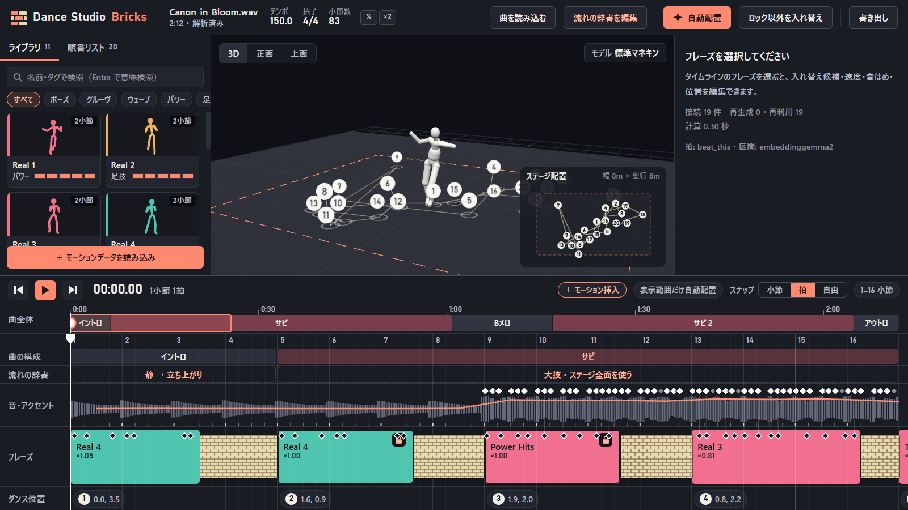

[日本語](README.md) | **English**

# Dance Studio Bricks

A desktop app that lines up dance phrases along the bars and tempo of a song, joins the phrases with [MotionBricks](https://github.com/NVlabs/MotionBricks), and exports the result as one continuous dance.



The app runs in Japanese or English. It starts in the language of your system, and the button at the right end of the top bar (`EN` / `日本語`) switches it. Phrase descriptions in the library and the specification ([SPEC.md](SPEC.md)) are in Japanese only.

## What it does

- **Song analysis:** Extracts tempo, beats, bars, song structure and sound accents.
- **Auto-arrange and manual editing:** Places phrases that suit the structure and intensity of the song on the bars. On the timeline you can change length and position, or swap a phrase for a candidate. Phrases can be copied and pasted with Ctrl+C and Ctrl+V.
- **Sound matching:** Aligns the accents of a move to the sound by stretching time locally inside the phrase. You can also drag a move accent onto a sound by hand.
- **Stage placement:** Set the floor position and facing of each phrase in the 3D view. From the right-click menu you can align a phrase exactly to where the previous one ends, which reduces foot sliding in the join.
- **Join generation:** The gaps between phrases are filled with MotionBricks. Each join is generated ahead and stored, so playback and export give the same result. After an edit, only the affected joins are rebuilt. You can also make joins of different lengths, compare them and pick one.
- **Several dancers and formations:** Add dancers and set where they stand as formations. Paths that would collide on the way are avoided automatically, and scenes where dancers get too close are reported. Right-click a dancer's name to show, hide or delete the dancer. Drag a dancer's body in the 3D view to move all of that dancer's phrases together.
- **Preview on a model:** A humanoid VRM / GLB / FBX model can dance in place of the default mannequin. Both T-pose and A-pose models load.
- **Export:** The finished motion is exported as BVH, FBX, VRMA (for VRM) or VMD (for MMD). For BVH and FBX you choose a T-pose or an A-pose rest pose (with the arm angle) to match the model you will apply it to. A GLB of a loaded GLB / FBX model with the motion can also be exported.

## How it works

| Stage | Technology |
|---|---|
| Page | Electron, TypeScript, three.js, [three-vrm](https://github.com/pixiv/three-vrm), Vite |
| Processing | Python, FastAPI |
| Beat detection | [Beat This!](https://github.com/CPJKU/beat_this) |
| Repeated-section detection, searching phrases by text | EmbeddingGemma 2 (optional) |
| Join generation | MotionBricks (kept running in its own environment) |
| FBX conversion | Blender's Python (`bpy`) |

The detailed specification is in [SPEC.md](SPEC.md) (Japanese).

## Requirements

| Item | Required | Recommended |
|---|---|---|
| OS | Windows 11 (64-bit) | same |
| GPU | An NVIDIA GPU with driver version 525 or later (CUDA 12) | Not fully occupied by other work |
| Screen | 1280×760 or larger | 1920×1080 or larger |
| Free space | About 20 GB (with every component installed; see the table under "Starting") | same |
| Network | Only for the first installation | same |
| Tools | Git for Windows. `uv` and Node.js are installed with winget at startup if missing | same |

- **OS:** The start and setup scripts are for Windows. Windows 10 and other systems have not been checked.
- **GPU:** Needed by MotionBricks, which makes the joins between phrases. MotionBricks cannot be installed on a non-NVIDIA GPU. Without MotionBricks you can still edit, and joins become straight interpolation.
- **Free GPU:** MotionBricks uses about 1.1 GB of VRAM while it runs (measured on the machine below). If image or video generation is using the whole GPU, joins are not generated in time and become straight interpolation.
- **Screen:** Designed for 1920×1080. The minimum window size is 1280×760.
- **Install location:** The path for models and other components must use only letters and digits (the default is `C:\AI`).
- **Memory:** The required amount has not been determined. With a song of 5 min 20 s, 2 dancers and 190 phrases loaded, the backend used about 0.3 GB. Song analysis and MotionBricks use memory on top of that.

It has been checked on this one machine only. Lower-spec PCs have not been checked.

| Item | Checked on |
|---|---|
| OS | Windows 11 Pro (build 26200) |
| GPU | NVIDIA GeForce RTX 4090 (24 GB VRAM, driver 610.88) |
| CPU | AMD Ryzen 9 9950X |
| Python / Node.js | 3.11.9 / 22.21.1 |

The Python environments and the models are installed automatically by the steps under "Starting".

292 dance phrases are included in `motions/`. They are imported into the library the first time the app starts, so it works out of the box (after that, `data/library/` is the source of truth and `motions/` is not read again). You can add your own phrases too. The only motion format that can be imported is **BONES-standard SOMA BVH**. Songs can be WAV / FLAC / MP3, and models VRM / GLB / FBX.

## Starting

Run `start.cmd`.

The first time, whatever is missing is prepared automatically.

1. **The app's own runtime:** If `uv` or Node.js is missing, the console asks whether to install it with winget. Then the Python environment and the page are prepared.
2. **Models and other components:** "Install required components" opens in the app. Choose what to install and where, agree to the licenses, and each component is downloaded straight from its publisher and installed.

| Component | Purpose | Required | Approx. size |
|---|---|---|---|
| MotionBricks | Generating the joins between phrases | Required | about 7 GB |
| Beat This! | Detecting beats and bars (librosa is used instead when missing, with lower accuracy) | Optional | about 4 GB |
| EmbeddingGemma 2 | Detecting repeated sections of a song, searching phrases by text | Optional | about 5 GB |
| Blender (`bpy`) | FBX export | Optional | about 0.7 GB |

An installation can be cancelled, and running it again continues where it stopped. You can also close the dialog and keep working; until it finishes, joins are shown as straight interpolation. All versions are pinned, and large files are verified by checksum.

The first-time setup of MotionBricks uses the GPU. It can take tens of minutes if other apps are using the GPU.

To use environments you already have, point to their `python.exe` with environment variables.

| Variable | Content |
|---|---|
| `DSB_MB_PYTHON` | `python.exe` of the MotionBricks environment |
| `DSB_EG2_PYTHON` | `python.exe` of the EmbeddingGemma 2 environment |
| `DSB_BPY_PYTHON` | `python.exe` of an environment with `bpy` |

## Language

- The page follows the system language: Japanese on a Japanese system, English otherwise. The `EN` / `日本語` button in the top bar switches it and remembers the choice.
- In English, tags and categories are shown in English, and a search typed in English finds them (`kick`, `high kick`, `jump`, `heart` …). The tags themselves are stored in Japanese, so a library is the same in both languages.
- Phrase descriptions, and the default texts of the flow dictionary once you have edited them, stay as they were written.
- Messages returned to MCP clients are in Japanese.

## MCP (for AI agents)

An MCP server (`dsb.mcp_server`) is included. AI agents (Antigravity, Claude Code, Codex and others) can load a song, search by feeling words, auto-arrange, fill a gap with several motions, cut, set formations, and export BVH / FBX / VRMA / VMD.

- **Antigravity:** recognised automatically in the workspace through `.agents/plugins/dance-studio-bricks/`.
- **Claude Code / Codex:** the `.mcp.json` at the root works as it is.
- While the desktop app is open, the server shares the same backend at `127.0.0.1:8765`, so changes show on the screen at once. When it is not open, the backend is started in the background (`DSB_PORT` / `DSB_URL` change where it connects).

## Tests

```bash
backend/.venv/Scripts/python.exe -m unittest discover -s backend/tests
```

## Current status

In development. These points have not been checked enough yet.

- VMD is checked numerically by reading the exported file back. Loading it in MMD itself has not been checked.
- VRMA is checked by playing it with three-vrm. Loading it in other apps has not been checked.
- GLB / FBX models are checked with a test humanoid. Distributed models may need their bone mapping fixed by hand.
- Several dancers are checked with 2 dancers.
- The English display covers the screens and messages of the app. Texts that are still missing from the dictionary appear in Japanese.

Joins are checked numerically (error at the start and end, joint speeds), but how they look in playback has yet to be evaluated. The automatic detection of song sections is still inaccurate, so it can be corrected under "Flow dictionary".

## License

The code in this repository is under the [MIT License](LICENSE).

MotionBricks, Beat This!, EmbeddingGemma 2, SOMA, motion material and the models you load each come under their own licenses. Check the terms of each publisher before use.

The rotations of SOMA's standard T-pose (`backend/dsb/soma_rest.py`) are values taken from the skeleton definition of NVIDIA Kimodo (Apache-2.0). The joint order and bone dimensions in the same file are those of the SOMA skeleton (NVIDIA, Apache-2.0), and they are also written into exported BVH and FBX files.

The default mannequin (`frontend/public/models/default-mannequin.glb`) is Quaternius's Universal Animation Library Mannequin (CC0 1.0).
