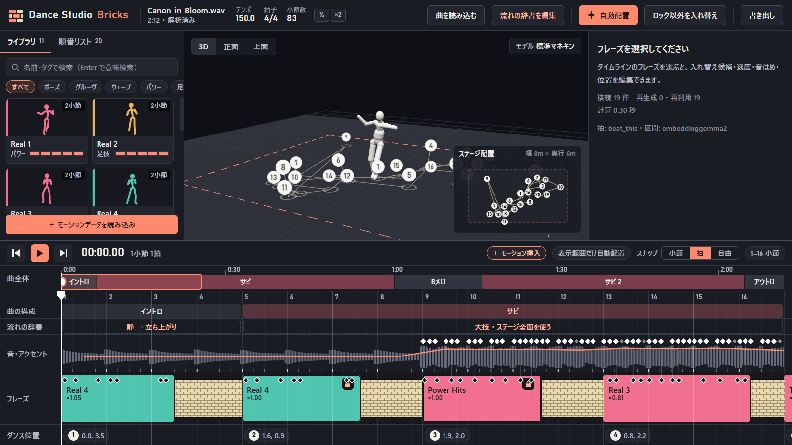

**日本語** | [English](README.en.md)

# Dance Studio Bricks

曲の小節とテンポに合わせてダンスフレーズを並べ、フレーズ同士を [MotionBricks](https://github.com/NVlabs/MotionBricks) でつないで、一続きのダンスとして書き出すデスクトップアプリです。



## できること

- **曲の解析:** テンポ、拍、小節、曲の構成、音のアクセントを取り出します。
- **自動配置と手動編集:** 曲の構成と強さに合うフレーズを小節に並べます。タイムラインで長さや位置を変えたり、候補と入れ替えたりできます。フレーズは Ctrl+C と Ctrl+V でコピーして貼り付けられます。
- **音はめ:** 振りのアクセントを音に合わせて、フレーズの中の時間を部分的に伸縮します。振りのアクセントを音へドラッグして、手で合わせることもできます。
- **ステージ配置:** フレーズごとに床の位置と向きを 3D 画面で指定します。右クリックから、前のフレーズが終わる位置にぴったり合わせることもできます（つなぎの足の滑りを抑えます）。
- **つなぎの生成:** フレーズ同士の隙間を MotionBricks で補間します。接続ごとに事前生成して保存するので、再生と書き出しは同じ結果になります。編集したときは、影響する接続だけを作り直します。長さの違うつなぎを作って比べ、選ぶこともできます。
- **複数人とフォーメーション:** ダンサーを追加して、立ち位置をフォーメーションとして決められます。移動の途中でぶつかる経路は自動でよけ、近づきすぎる場面を知らせます。ダンサーの名前を右クリックすると、ステージでの表示と非表示の切り替え、削除ができます。3D 画面でダンサーの体をドラッグすると、そのダンサーのフレーズの位置がまとめて動きます。
- **モデルで確認:** VRM / GLB / FBX の人型モデルを、標準マネキンの代わりに踊らせます。T ポーズと A ポーズのどちらのモデルでも読み込めます。
- **書き出し:** 完成したモーションを BVH、FBX、VRMA（VRM 用）、VMD（MMD 用）で書き出します。BVH と FBX は、取り込み先のモデルに合わせて、T ポーズ基準か A ポーズ基準（腕の角度を指定）かを選べます。読み込んだ GLB / FBX モデルに動きを付けた GLB も書き出せます。

画面は日本語と英語で表示できます。初回は PC の言語に合わせ、上のバーの右端のボタン（`EN` / `日本語`）で切り替えます。

## 仕組み

| 段階 | 使っている技術 |
|---|---|
| 画面 | Electron、TypeScript、three.js、[three-vrm](https://github.com/pixiv/three-vrm)、Vite |
| 処理 | Python、FastAPI |
| 拍の検出 | [Beat This!](https://github.com/CPJKU/beat_this) |
| 反復区間の検出、文章でのフレーズ検索 | EmbeddingGemma 2（任意） |
| つなぎの生成 | MotionBricks（専用の環境で常駐） |
| FBX 変換 | Blender の Python（`bpy`） |

詳しい仕様は [SPEC.md](SPEC.md) にあります。

## 動作環境

| 項目 | 必要なもの | 推奨 |
|---|---|---|
| OS | Windows 11（64 ビット） | 同じ |
| GPU | NVIDIA の GPU と、バージョン 525 以降のドライバ（CUDA 12 対応） | ほかの処理が GPU を使い切っていない状態 |
| 画面 | 1280×760 以上 | 1920×1080 以上 |
| 空き容量 | 約 20 GB（すべての環境を導入する場合。内訳は「起動」の表） | 同じ |
| ネットワーク | 初回の導入のときだけ | 同じ |
| 道具 | Git for Windows。`uv` と Node.js は、無ければ起動時に winget で導入します | 同じ |

- **OS:** 起動と準備のスクリプトが Windows 用です。Windows 10 と、Windows 以外では確認していません。
- **GPU:** フレーズ同士のつなぎを作る MotionBricks に必要です。NVIDIA 以外の GPU では MotionBricks を導入できません。MotionBricks が無いあいだも編集はでき、つなぎは直線の補間になります。
- **GPU の空き:** MotionBricks は、常駐中に VRAM を約 1.1 GB 使います（下の環境での実測）。画像や動画の生成などが GPU を使い切っていると、つなぎの生成が間に合わず、直線の補間になります。
- **画面:** 1920×1080 を基準に作っています。ウィンドウの最小サイズは 1280×760 です。
- **インストール先:** モデルなどの環境の導入先は、英数字だけのパスにします（既定は `C:\AI`）。
- **メモリ:** 必要な量は確認していません。5 分 20 秒の曲、ダンサー 2 人、フレーズ 190 本を読み込んだ状態で、バックエンドが使うメモリは約 0.3 GB でした。曲の解析と MotionBricks は、これとは別にメモリを使います。

動作を確認しているのは、次の 1 台だけです。これより性能の低い PC では確認していません。

| 項目 | 確認した環境 |
|---|---|
| OS | Windows 11 Pro（ビルド 26200） |
| GPU | NVIDIA GeForce RTX 4090（VRAM 24 GB、ドライバ 610.88） |
| CPU | AMD Ryzen 9 9950X |
| Python / Node.js | 3.11.9 / 22.21.1 |

Python の環境やモデルは、次の「起動」の手順で自動的に導入します。

ダンスフレーズ 292 本を `motions/` に同梱しています。初回の起動時にライブラリへ取り込むので、そのまま使えます（取り込んだあとは `data/library/` が正本で、`motions/` は読み直しません）。自分のフレーズを足すこともできます。読み込めるモーションは **BONES 基準の SOMA BVH** だけです。曲は WAV / FLAC / MP3、モデルは VRM / GLB / FBX を読み込めます。

## 起動

`start.cmd` を実行します。

初回は、足りないものを自動で準備します。

1. **アプリの実行環境:** `uv`、Node.js が無い場合は、winget で導入してよいかをコンソールで確認します。そのあと Python 環境と画面を準備します。
2. **モデルなどの環境:** アプリの画面に「必要な環境の導入」が開きます。導入するものとインストール先を選び、ライセンスに同意すると、配布元から直接ダウンロードして導入します。

| 環境 | 用途 | 必須 | 容量の目安 |
|---|---|---|---|
| MotionBricks | フレーズ同士のつなぎの生成 | 必須 | 約 7 GB |
| Beat This! | 拍と小節の検出（無い場合は librosa で代用し、精度が下がります） | 任意 | 約 4 GB |
| EmbeddingGemma 2 | 曲の反復区間の検出、文章でのフレーズ検索 | 任意 | 約 5 GB |
| Blender（`bpy`） | FBX の書き出し | 任意 | 約 0.7 GB |

導入は途中で中止でき、もう一度実行すると続きから再開します。閉じて作業を続けることもでき、終わるまでつなぎは直線の補間で表示します。バージョンはすべて固定で、大きなファイルはチェックサムで照合します。

MotionBricks の初回の準備には GPU を使います。他のアプリが GPU を使っていると、数十分かかることがあります。

すでに導入済みの環境を使うときは、環境変数でその `python.exe` を指定できます。

| 環境変数 | 内容 |
|---|---|
| `DSB_MB_PYTHON` | MotionBricks の環境の `python.exe` |
| `DSB_EG2_PYTHON` | EmbeddingGemma 2 の環境の `python.exe` |
| `DSB_BPY_PYTHON` | `bpy` を入れた環境の `python.exe` |

## MCP（AI エージェント連携）

AI エージェント（Antigravity、Claude Code、Codex など）から曲の読み込み・感覚語検索・自動配置・補間区間の複数モーション割り当て・カット・フォーメーション・BVH / FBX / VRMA / VMD 書き出しまで操作できる MCP サーバー（`dsb.mcp_server`）を同梱しています。

- **Antigravity:** `.agents/plugins/dance-studio-bricks/` によりワークスペースで自動認識されます。
- **Claude Code / Codex:** ルートの `.mcp.json` をそのまま利用できます。
- デスクトップ画面を起動中であれば同じ `127.0.0.1:8765` バックエンドを共有して画面にも即座に反映され、未起動の場合はバックエンドを裏で自動起動します（`DSB_PORT` / `DSB_URL` で接続先変更可）。

## テスト

```bash
backend/.venv/Scripts/python.exe -m unittest discover -s backend/tests
```

## 現在の状況

開発中です。次の点は、確認がまだ十分ではありません。

- VMD は、書き出したファイルを読み戻して数値で確認しています。MMD 本体での読み込みは未確認です。
- VRMA は three-vrm で再生して確認しています。ほかのアプリでの読み込みは未確認です。
- GLB / FBX モデルは、試験用の人型で確認しています。配布されているモデルでは、骨の対応を手で直す必要があるかもしれません。
- 複数人は 2 人で確認しています。

つなぎは始点と終点の誤差や関節速度を数値で確認していますが、再生したときの見た目の評価はこれからです。曲の区間の自動判定はまだ精度が低いので、「流れの辞書を編集」から修正できるようにしています。

## ライセンス

このリポジトリのコードは [MIT License](LICENSE) です。

MotionBricks、Beat This!、EmbeddingGemma 2、SOMA、モーション素材、読み込むモデルには、それぞれのライセンスが適用されます。利用する前に各配布元の条件を確認してください。

SOMA の標準 T ポーズの回転（`backend/dsb/soma_rest.py`）は、NVIDIA Kimodo（Apache-2.0）の骨格定義から取り出した値です。同じファイルの関節の並びと骨の寸法は、SOMA（NVIDIA、Apache-2.0）の骨格のもので、書き出す BVH と FBX にも入ります。

標準のマネキン（`frontend/public/models/default-mannequin.glb`）は、Quaternius の Universal Animation Library Mannequin（CC0 1.0）です。
